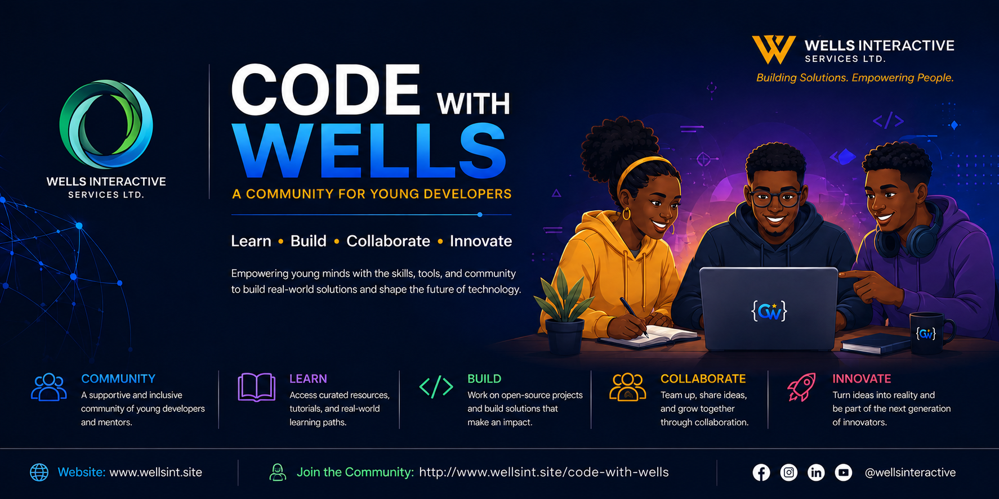

# 👨‍💻 Code With Wells Program!

<div align="center">



### **Inspiring the Next Generation of Developers**

*A community where young people learn, build, collaborate and launch real-world software.*


**Designed & Managed by Wells Interactive Services Ltd.**

🌐 http://www.wellsint.site
🔗 https://linktr.ee/wellsinteractive

</div>

---

# 🚀 Welcome to Code With Wells

Welcome to the **Code With Wells** community!

This repository is the **official development hub** for the Code With Wells Program, a growing initiative dedicated to equipping young people with practical software engineering skills through mentorship, collaboration, and real-world projects.

Whether you're writing your first line of code or contributing to production-ready applications, you're welcome here.

---

# 🌍 What is Code With Wells?

Code With Wells is a developer education and mentorship initiative founded by **Wells Interactive Services Ltd.** Founder **[Mr. Wells](https://linktr.ee/mrwellslife)**.

Our mission is simple:

> **Teach. Build. Collaborate. Innovate.**

Instead of learning only through tutorials, participants gain experience by contributing to actual software projects used in the real world.

Members learn by:

* Building applications
* Solving real development problems
* Contributing to open-source projects
* Learning industry best practices
* Working as part of development teams
* Receiving mentorship from experienced developers

---

# 🎯 Our Mission

Our mission is to develop the next generation of African software engineers by providing access to practical experience, mentorship, collaboration, and modern development tools.

We believe that talent should never be limited by access to opportunities.

---

# 🌟 What You'll Learn

Members gain experience in areas including:

* Web Development
* Mobile App Development
* Artificial Intelligence
* Automation
* API Development
* Git & GitHub
* Linux
* Database Design
* Software Architecture
* Team Collaboration
* Open Source Development

---

# 📚 Repository Structure

This repository serves as the central workspace for Code With Wells projects. Submodules are private

```text
CodeWithWells/
│
├── brainyte-ai-terminal-helper/     # Git Submodule
├── docs/
├── tutorials/
├── examples/
├── assets/
├── README.md
└── ...
```

As the community grows, additional repositories and tools will be managed from this central hub.

---

# 🧩 Featured Projects

Current and upcoming community projects include:

* 🧠 Brainyte AI Terminal Helper
* 💻 Mobile Security Extensions
* 🤖 AI Development Tools
* 📚 Learning Examples
* 🎓 Coding Tutorials
* 🔧 Open Source Utilities
* 🌐 Community Starter Templates

---

# 🤝 How to Get Involved

We welcome learners, developers, designers, technical writers, testers, and mentors.

### Join the Community

Become a member of the Code With Wells Program:

👉 https://forms.gle/dYAQwweHzUSqNuwC8

                    OR

👉http://www.wellsint.site/code-with-wells

---

### Explore Resources

Browse our:

* Tutorials
* Documentation
* Sample Projects
* Learning Materials
* Community Discussions

---

### Contribute

Help improve existing projects or build something new.

Every contribution matters.

---

### Attend Community Events

Members will have opportunities to participate in:

* Coding Challenges
* Workshops
* Bootcamps
* Hackathons
* Live Coding Sessions
* Community Meetups
* Open Source Sprints

---

# 💙 Community Values

we believe in:

* Respect
* Kindness
* Curiosity
* Teamwork
* Innovation
* Continuous Learning
* Giving Back

No matter your experience level, everyone deserves to be treated with respect.

> **Leave your ego in your pocket. Bring your curiosity instead.**

---

# 📜 Code of Conduct

We are committed to providing a welcoming environment for everyone.

Members are expected to:

* Respect every community member
* Encourage learning
* Share knowledge freely
* Accept constructive feedback
* Communicate professionally
* Build together

Harassment, discrimination, toxicity, and abusive behaviour will not be tolerated.

---

# 🚀 Contributing

Want to contribute?

1. Fork this repository.
2. Create a new branch.
3. Make your improvements.
4. Commit your changes.
5. Submit a Pull Request.

We welcome contributions of all sizes.

---

# 🛠 Development Workflow

```bash
git clone --recurse-submodules https://github.com/Wells-Interactive/CodeWithWells.git

cd CodeWithWells
```

Update all submodules:

```bash
git submodule update --init --recursive
```

---

# 📈 Roadmap

* Community Documentation
* Developer Bootcamp Curriculum
* AI Developer Toolkit
* VS Code Extension
* Open Source Projects
* Coding Challenges
* Learning Portal
* Certification Program
* Internship Opportunities
* Community Showcase

---

# 💡 Our Vision

To become one of Africa's leading technology communities where young developers can learn, collaborate, innovate, and launch impactful software solutions that solve real-world problems.

---

# ❤️ Special Thanks

A huge thank you to every mentor, contributor, volunteer, partner, and community member helping build the future of technology through CodeWithWells.

Together, we're creating opportunities, building careers, and changing lives—one line of code at a time.

---

# 🌐 Connect With Us

**Website**
http://www.wellsint.site

**Brainyte**
http://www.wellsint.site/brainyte

**Community Registration**

https://forms.gle/dYAQwweHzUSqNuwC8

**Linktree**
https://linktr.ee/wellsinteractive

---

<div align="center">

## **Code. Learn. Build. Inspire.**

</div>

